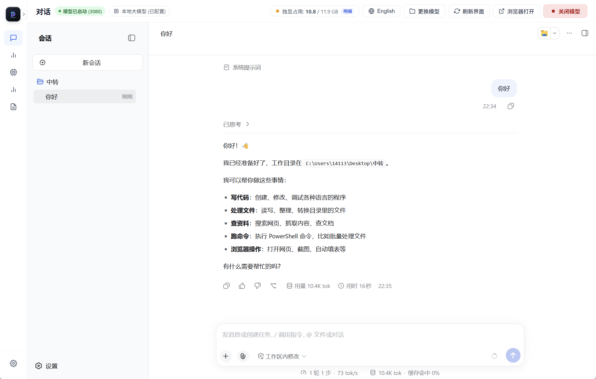

<div align="center">

# Sparkle-Qwen27b-Kvmem-ninfer

**A local 27B Agent on a 12GB laptop GPU**

NInfer inference · KVMem tiered KV · MTP3 speculative decoding · dsh Agent workspace

[](docs/RELEASE_V1.2.0.md)
[](docs/RELEASE_V1.2.0.md)
[](docs/BUILD.md)
[](LICENSE)

[Quick start](#quick-start) · [v1.2.0](#v120-update) · [Measurements](#measurements) · [Docs](#documentation-map) · [Download](https://github.com/CSUNX233/Sparkle-Qwen27b-Kvmem-ninfer/releases/tag/v1.2.0)

</div>

> **The logical context is 256K, but not every step reads all history.** KVMem keeps cold KV in Host RAM and retrieves pages into GPU memory. This reduces repeated prefill; it is not a completed full-256K validation and does not guarantee that every task is faster.

## At a glance

| Question | Answer |
|---|---|
| **What is this?** | A local Agent stack for coding, files and web tasks: NInfer engine + KVMem long history + MTP3 + optional dsh web UI / Pmod desktop. |
| **Where does it run?** | Directly validated on **RTX 5070 Ti Laptop 12GB / i7-14650HX / 32GB RAM / Windows**. Other 12GB+ GPUs need architecture-matched builds. |
| **Defaults?** | Qwen3.8-27B GSQ-RCO IQ3_XXS + MTP3, **RK4V4 + GDN FP32**, DeviceKV 36864 / Retrieve 3840 / HostKV 7168 MiB, xhigh. |
| **v1.2.0 focus?** | CPU vision chunk-boundary fix, bounded recovery from truncated summaries, and restored DSH reasoning controls. |
| **What it is not?** | Proof that every task beats cloud models or that all similarly named errors and tool loops are resolved. |

> **Desktop:** the repository also contains the **Pmod** GUI in [`desktop/`](desktop/) (Tauri 2 + Vue 3.5): chat, model configuration, VRAM monitoring and an OpenAI-compatible gateway. The installer build script is [`scripts/build-inno-installer.ps1`](scripts/build-inno-installer.ps1). It is an optional frontend and does not change the engine or default Agent.



## v1.2.0 update

- **Image boundary:** CPU/host-staged vision with MTP could hit a `scatter` shape error when the first image token landed at a prefill boundary. The fix stages the needed next column without increasing the planned worst-case staging allocation.
- **Compaction recovery:** if a local model's first summary reaches the output cap, discard it and retry that auxiliary summary once at low reasoning effort. An incomplete retry preserves history and stops the turn; normal conversation settings are unchanged.
- **DSH and deployment:** model/reasoning controls are enabled and GPU vision can be selected explicitly. The public 36864/3840 starting budget remains unchanged; vision is off by default.
- **Validation:** a real task reached about 212K input tokens and exposed the old summary truncation. A real-model replay produced a complete summary; an isolated DSH transaction and a two-image xhigh tool continuation were checked. One earlier continuation made an extra tool call; a stricter repeat passed, which does not rule out every loop.

[Download the v1.2.0 engine asset](https://github.com/CSUNX233/Sparkle-Qwen27b-Kvmem-ninfer/releases/download/v1.2.0/ninfer-5070ti-win-x64-sm120a-v1.2.0.zip). It contains the engine only, without model weights, DSH or runtime DLLs. Engine SHA-256: `f9a6b29cb7755b18ae02dcc130c17b5e28b2c97530c647db9936680bd5c2ad46`. See the [release details and test limits](docs/RELEASE_V1.2.0.md). After updating source, run `setup.ps1` to update the installed engine and DSH patches.

## v1.1.0 update (historical)

Verified engine SHA-256:

```text
8b2c195e32e3b58a3584b284679c990a07986691967f1b939b0fe31351559012
```

### Two engine-level changes

| Change | Effect |
|---|---|
| **Fill the predecessor of a high-scoring history page** | Evidence can span two KV pages while the old selector kept only the second. The new path uses overlap-retrieval slots to add the predecessor: at most **8 pages** per selection, only replacing lower-ranked members of the recent range, with **no increase in total selected pages** and all original cold pages retained. |
| **Wait for complete query scoring** | Filling is allowed only after the known query end has been read and the full captured query has been scored. Unknown/incomplete queries keep the old selection. This removes the previous candidate's 218K regression. |

- Enabled by default; `NINFER_KVMEM_OVERLAP_PREDECESSOR=0` restores v1.0.0 selection.
- **Selection diagnostics are off by default.** Only `NINFER_KVMEM_RANK_AUDIT_DIR=<dir>` writes per-generation scores and page lists; those files may contain prompt-derived page numbers and must not be published.

| Fixture | Previous daily | Current daily |
|---|---|---|
| **110K long task** | 4096 output budget exhausted, no final answer | **12/12 complete** (733 output tokens, `finish=stop`, 275.9 s, peak 11,232 MiB) |
| **218K long task** | 26/26 | **26/26, normalized JSON matches the correct baseline** (`finish=stop`, peak 11,240 MiB) |

The disabled same-lineage baseline peaked at 11,230/11,242 MiB; the 2 MiB difference at 110K is disclosed, not claimed as strictly zero-cost. Only these two fixtures were rerun.

**Minimal malformed tool-envelope fix.** A closed `<tool_call>` contained `=job_output>` without the function opener and with malformed parameter tags. The old parser returned plain text, so dsh ended the turn. The new path recognizes only a standalone whole answer with a closed envelope, valid name, parameter opener and complete close, and routes it to the existing `malformed_tool_call` error path. It never guesses or executes the arguments; the error includes `intended_function` and a correct Qwen tag example. Ordinary text, Markdown code, truncated envelopes and valid `job_output` remain unchanged. The full C++ parser suite and the new regression pass.

### Deployment and dsh

- **RK4V4 + GDN FP32 default.** The daily 39,168/6,144 setup peaks at 11,220-11,236 MiB, +52..+68 MiB versus 11,168 MiB, within the +100 MiB constraint; runtime headroom is about 12 MiB. On 39 short questions, mean TV versus BF16 is 0.0262 with 0 prediction flips (NVFP4: 0.0288 / 1); a 189,954-token real-content fixture passed 24/24. The public example keeps the safer 36,864/3,840 starting pool.
- **dsh state card v0.1.2.** Appends a deterministic card after significant tool results (goal, files, attempts, last error, code signatures/constants): immediately on errors, every write/edit, and every third shell call; capped at 1,900 characters. It does not rewrite history, tool arguments, prompts, sampling or KV. v0.1.2 expands nested `tool-result.content` and stops injecting once a session contains an image.
- **Post-release fix (v0.1.3, main).** The old trigger used `attempts.length % 3`; `attempts` is capped at 8 entries, so ordinary shell calls stopped emitting cards once it filled. v0.1.3 uses a separate `shellCalls` counter; the nine-shell integration test emits at calls 3/6/9, while the old code emits only the first two. The v1.1.0 release dsh ZIP still contains v0.1.2; use `main` or wait for the next dsh package update.
- Five-run refactor A/B: P0 **15.8 steps / 23.4 calls / 0.8 duplicates / 43,164 context / 260 s**; baseline **16.0 / 25.4 / 2.40 / 53,825 / 348 s**; both 5/5 tests. **Step count is flat (-1.3%) and ranges overlap; n=5 is not statistically significant.** Pruner threshold changes and `pruner-bridge` remain experimental and are not in the daily profile.

### v1.1.0 known issue (historical)

A 99-message, 7-media request after compaction failed during prefill with:

```text
scatter: expected src [D,V], indices [V], dst [D,T]
```

HTTP 500; `--recover-invariant-failures` kept the engine alive, but continuing the failed session reuses the same compacted history and fails again. Use a **new session**; v0.1.2's media guard only affects new injections. The root cause is in the vision/state tensor path and is not fixed by this release.

### Install and rollback

- Source tag: `v1.1.0`.
- Engine asset: [`ninfer-5070ti-win-x64-sm120a-v1.1.0.zip`](https://github.com/CSUNX233/Sparkle-Qwen27b-Kvmem-ninfer/releases/download/v1.1.0/ninfer-5070ti-win-x64-sm120a-v1.1.0.zip), archive SHA-256 `daa2a6c5ab0c6a1715d839fcaf3ee4954c6c19d2641f9ee9aec6de083a3bae4a`, containing engine `8b2c195e...`.
- dsh package: [`dsh-state-card-v1.1.0.zip`](https://github.com/CSUNX233/Sparkle-Qwen27b-Kvmem-ninfer/releases/download/v1.1.0/dsh-state-card-v1.1.0.zip), SHA-256 `cf37d659dd7439841dda362c0c341ff04377655592e822cadc524f3fd8bf2ab1`, containing state-card v0.1.2, tests and a manual profile snippet; the source installer already mounts it.
- Rollback: v1.0.0 engine `71259a21f7b525ca7477193a292e4d3623cc58b9efd785005ee934cc29673507`; v0.1.5 engine `38bc4d8c6be07afd6c74b902cc33403bf2ee139a2c50129d363d68d74a7609d6`.
- A `git pull` does not replace the exe; rerun `setup.ps1`. The engine still reports the 1.0.0 base version; identify it by SHA-256 and tag.

## Quick start

### Option A: source install (recommended)

Requires **Node.js 24+**, the **VC++ x64 runtime**, a CUDA 13-compatible NVIDIA driver, and a v3 `.ninfer` model containing MTP.

```powershell
git clone https://github.com/CSUNX233/Sparkle-Qwen27b-Kvmem-ninfer.git
cd Sparkle-Qwen27b-Kvmem-ninfer
powershell -NoProfile -ExecutionPolicy Bypass -File .\setup.ps1 `
  -ModelPath "D:\Models\qwen3.8-27b-gsq-rco-iq3-xxs.ninfer"
.\start.cmd
```

The first start downloads checksum-pinned dependencies, loads weights and captures CUDA graphs. The private dsh login URL is written to `runtime/logs/dsh.stdout.log`; **do not publish it**.

### Option B: engine asset

Download the `v1.2.0` ZIP, place `ninfer-serve.exe` in `runtime/engine/`, then run `setup.ps1`. The asset contains no model, Node, dsh or runtime DLLs.

### Default ports

| Service | Address |
|---|---|
| Engine API | `http://127.0.0.1:1234/v1` |
| Cache guard | `http://127.0.0.1:1236/v1` |
| dsh UI | `http://127.0.0.1:3080` |

## Measurements

> Not a unified benchmark: binaries, ports and fixtures differed. Full data and limits: [v1.1.0 quality record](docs/QUALITY_FIDELITY_V1.1.0.md) and [`benchmarks/evidence/v1.1.0/`](benchmarks/evidence/v1.1.0/).

### Short-context fidelity (39 questions, first-token distribution)

| Config | Correct | Mean TV vs BF16 | Prediction flips |
|---|---:|---:|---:|
| BF16 | 35/39 | 0 | - |
| FP8 | 36/39 | 0.0152 | 1 |
| **RK4V4 + GDN32 (default)** | **35/39** | **0.0262** | **0** |
| NVFP4 + GDN32 | 34/39 | 0.0288 | 1 |
| NVFP4 + GDN16 | 35/39 | 0.0299 | 2 |

Same-config repeats were bit-identical. Thinking-off arithmetic still flips on `3^5-2^6`; the daily xhigh path passed 4/4. Do not use thinking-off arithmetic as a daily-quality verdict.

### VRAM (whole-GPU peak, nvidia-smi)

| Config | Pool | GDN | Peak MiB | vs previous daily |
|---|---:|---|---:|---:|
| Previous daily NVFP4 | 39,168 | FP16 | 11,168 | - |
| RK4V4 | 39,168 | FP16 | 11,148 | -20 |
| NVFP4 | 38,528 | FP32 | 11,226 | +58 |
| **RK4V4 (current)** | **39,168** | **FP32** | **11,220-11,236** | **+52..+68** |

This is the maintainer's full-pool advanced profile, not a public guarantee. Headroom is about 12 MiB; if OOM, reduce the pool to 38,912/38,400 first.

### Long context and real content

| Fixture | Result | Note |
|---|---:|---|
| 110K / 12 sequential pins | 12/12 | RK4V4; FP8 with the same pool was 8/12 |
| 159K / 16 sequential pins | 16/16 | rk8v4 small pool |
| 232K / 24 sequential pins | 24/24 | Sequential codes are easy to extrapolate |
| 232K random-order stress | Not a release claim | Unstable across repeats and common across formats |
| **189,954-token real-content multi-turn** | **24/24** | 16 code facts + 8 earlier conversation facts; all three arms 24/24 |

### Tool/JSON regression

22 tool/JSON cases: **20/22**, same score and failures as v1.0.0. Two-route arithmetic under xhigh: **4/4**. 66K input + 3,668 output tokens completed without OOM.

## Hardware and models

| Hardware | Recommendation |
|---|---|
| **RTX 50 series, 12GB+** | Use this Windows x64 / sm120a asset; directly tested on 5070 Ti Laptop 12GB. |
| RTX 30 / 40 series, 12GB+ | Requires an architecture-matched build; see [build guide](docs/BUILD.md). The sm120a asset will not run. |
| 16GB+ | Larger IQ3_S text models are possible; prepare a matching `.ninfer` with MTP and revalidate the budget. |

32GB system RAM, an SSD and a CUDA 13-compatible driver are recommended. Renaming the executable does not change GPU support.

### When VRAM is short

1. Enable hybrid graphics so desktop/browser use the iGPU.
2. Set **CUDA - Sysmem Fallback Policy** to *Prefer No Sysmem Fallback* for the actual engine only.
3. Close unrelated GPU apps.
4. If still short, reduce the pool and retrieval together (for example 34,560 / 1,536), keeping sink/recent/HostKV.
5. **NVFP4 is not a VRAM-saving option**; the default RK4V4 already uses about 20 MiB less at the same pool.

Keep the 7 GiB KVMem Host KV: it is not the driver's overflow buffer. Smaller retrieval may reduce recall, and changing KV format can change output. [Full steps](docs/VRAM_GUIDE.md)

## How it works

```text
request -> dsh Agent / tools -> cache guard -> NInfer engine
                                             |- GPU hot pages (sink + recent + retrieve)
                                             |- Host KV (cold history, restored on demand)
                                             `- MTP3 speculative decoding
```

- **KVMem** keeps cold history KV in Host RAM and restores selected pages to GPU; it does not reread all history every step.
- **MTP3** uses three draft tokens for speculative decoding; daily sampling and xhigh stay unchanged.
- **Cache guard** keeps the sent prefix stable and reduces repeated prefill; it cannot make different token prefixes share KV safely.
- **dsh Agent** adds pre-execution edit validation, a task ledger, tool-result fidelity and the state card. These are behavior/context layers, not a replacement for engine quality.

## Documentation map

| I want to... | Read |
|---|---|
| **Install / upgrade / troubleshoot** | [Install](docs/INSTALL.md) · [Deployment guide](docs/DEPLOYMENT_AGENT_GUIDE.md) · [Troubleshooting](docs/TROUBLESHOOTING.md) |
| **Understand v1.2.0 and its test limits** | [v1.2.0 details](docs/RELEASE_V1.2.0.md) · [Sanitized validation summary](benchmarks/evidence/v1.2.0/validation.json) |
| **Understand v1.1.0** | [v1.1.0 quality record](docs/QUALITY_FIDELITY_V1.1.0.md) · [Release notes](docs/RELEASE_NOTES.md) |
| **Inspect the two engine patches** | [Predecessor fix](docs/DEFERRED_NEIGHBOR_FIX.md) · [Tool-envelope fix](docs/TOOL_ENVELOPE_FIX.md) |
| **See sanitized data** | [`benchmarks/evidence/v1.1.0/`](benchmarks/evidence/v1.1.0/) · [`benchmarks/qualification/`](benchmarks/qualification/) |
| **Build from source** | [Build guide](docs/BUILD.md) · [Modification scope](docs/MODIFICATIONS.md) |
| **dsh plugins / Agent behavior** | [Integrations](integrations/README.md) |
| **History** | [v1.0.0 query/execution layer](docs/RELEASE_NOTES.md) · [v0.1.5 C2.1](docs/C2P1_V014_PORT.md) |

## Limits

- **Full 256K is not validated.** The logical capacity is 262,144; dsh compaction is around 184K, and long-history middle sections are retrieved by page selection.
- **232K random-string stress is not a real-task metric.** Results were unstable across repeats and common across formats; real-content 190K passed 24/24.
- **A `scatter` message can have multiple causes.** This release fixes a reproducible CPU vision boundary case; the original remote logs are unavailable, so not all similarly named failures can be claimed fixed. See the [validation scope](docs/RELEASE_V1.2.0.md).
- **State-card n=5 is not statistically significant.** Steps are flat; the directional gain is fewer duplicates/context/time.
- **The prebuilt engine covers Windows x64 / sm120a only.** RTX 30/40 and other models need their own builds and validation.
- **Search needs the internet.** dsh search is not an offline index; site changes or captchas can break it.
- **Private requests, sessions and logs stay local.** Public directories contain sanitized aggregates only.

## History

<details>
<summary><b>v1.0.0 - query stability and agent execution guards</b></summary>

On the unchanged v0.1.5 model, NVFP4, 39168/6144 pool, MTP3, xhigh, sampling and answer-penalty settings:

- `related-tool-head`, `suffix refresh=tail`, `QUERY_ASSEMBLE=1`; on a real 116,907-token fault history, complete path + valid read/edit improved **1/4 -> 4/4**, and the 8-seed holdout **4/8 -> 8/8**.
- `edit-guard` validates single-file exact replacements before execution; `task-ledger` reminds the model of remaining actions. One structured retry recovered **10/10** recorded failures (generic 0/10).
- Causal **8/8**; short continuation **10/12, 7/12** (flat); delayed-stress first pass still **2/4**; H7/H8/H11 rejected and archived.
- Engine `71259a21...`; source tag `v1.0.0`. See [Release Notes](docs/RELEASE_NOTES.md) and [path-query experiment](docs/PATH_QUERY_EXPERIMENT.md).

</details>

<details>
<summary><b>v0.1.5 - C2.1 long-history cache restoration</b></summary>

C2.1 on v0.1.4: rolling long anchors, same-lineage anchor consumption, and cold-page demotion in batches of up to 32. 12 targeted regressions passed; two ~68K fixtures ran seven requests each, with needle fields 7/7 and state/code checks 6/6 before/after compaction. Final continuations reused 58,330/58,459 tokens in 1.93/2.77 seconds. Whole-GPU peaks were 11,176/11,174 MiB, with no matched v0.1.4 comparison. [Full record](docs/C2P1_V014_PORT.md)

</details>

## License and attribution

Code is **Apache-2.0**; third-party components and models keep their own licenses. Huihui Swift derivatives use the **Swift Open License v1.0**, including a commercial revenue threshold. Do not treat the whole model as Apache-2.0. [Model licenses](docs/MODELS.md)

Special thanks to Bilibili [0xFFFF7](https://search.bilibili.com/upuser?keyword=0xFFFF7): the foundation came from their shared distribution, and they fixed the earlier loop issue. See [upstream attribution](docs/UPSTREAM_DOWNSTREAM.md) and [NOTICE](NOTICE).

---

<div align="center">

**[Back to top](#sparkle-qwen27b-kvmem-ninfer)** · [Download v1.2.0](https://github.com/CSUNX233/Sparkle-Qwen27b-Kvmem-ninfer/releases/tag/v1.2.0) · [Open an issue](https://github.com/CSUNX233/Sparkle-Qwen27b-Kvmem-ninfer/issues)

</div>
